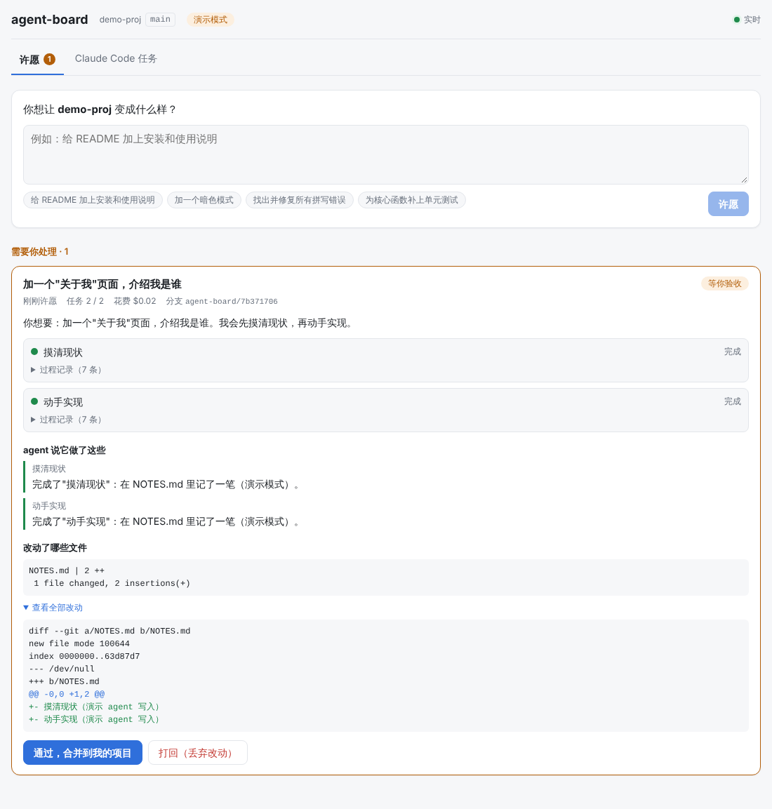

# agent-board

**许愿式的 agent 看板**：用一句话说想让项目变成什么样，规划员把愿望拆成任务，分给几位 Claude Code agent（调研员、开发者）同时去做。你在网页上实时看到谁在做什么，做完看报告和改动，满意了点"通过"才合并进你的项目。



## 一条命令启动

在你的项目目录里（需要是 git 仓库）运行：

```bash
npx github:rizornyquist351-gif/agent-board
```

第一次运行会自动下载并构建，之后浏览器会自动打开看板。缺什么（git、Claude Code、登录）页面上都会告诉你怎么办。

需要：[Node.js](https://nodejs.org) 22 或更高版本、git、已安装并登录的 [Claude Code](https://code.claude.com)（终端里能运行 `claude`）。

### 先不花钱试一试

演示模式用假 agent，不调用 Claude、不花钱，但会真的建分支、提交、合并。建议拿一个测试仓库体验完整流程：

```bash
AGENT_BOARD_FAKE=1 npx github:rizornyquist351-gif/agent-board /path/to/a/test/repo
```

## 你只需要做三件事

1. **许愿**：写一句话，比如"给 README 加上安装和使用说明"。
2. **确认**：规划员读完你的项目，把愿望拆成几个任务，标好谁来做（调研 / 开发）、谁要等谁。你看一眼，可以改、可以删，点"开始"。
3. **验收**：做完后看每个任务做了什么、调研报告、改了哪些文件，满意就"通过，合并到我的项目"，不满意就"打回"。

干活的时候，顶部的"谁在干活"面板实时显示每个 agent 正在做什么（"正在看 src/app.ts""正在运行命令：运行测试"……），需要你处理的事排在最上面，浏览器标签页标题也会显示数量；还可以开启桌面提醒。

## 它是怎么干活的

- **调研员**：只能读代码、上网查资料，产出一份报告，交给后面的开发者。
- **开发者**：每人一个独立的 git 工作区，改完自动合并到这次许愿的分支。两个人改到同一处时，后合并的那个会基于最新代码自动重做一次。
- 没有先后关系的任务**同时开工**，默认最多 3 个 agent 同时干活（可以同时许好几个愿）。
- 验收时如果你的项目在这期间有了新改动、和这次许愿冲突，会自动派一位开发者解决冲突，解决完再请你验收。

## 安全

- agent 只在独立的 git 分支里干活（工作区在 `~/.agent-board/worktrees/`，不在你的项目里）。**你点"通过"之前，你的项目不会有任何变化。**
- 合并时如果你的项目里有没提交的改动，看板会拒绝合并，免得弄乱你的东西。
- 运行代码产生的临时文件（`__pycache__`、`node_modules`、日志等）不会被提交。
- 每一步都有费用上限（默认规划 $0.5、每个任务 $2），页面上显示每个愿望花了多少。
- 看板只监听本机（127.0.0.1），并拒绝来自其他网站的请求。

## 可选设置

| 环境变量 | 默认值 | 作用 |
|---|---|---|
| `AGENT_BOARD_MAX_AGENTS` | `3` | 同时最多几个 agent 干活 |
| `AGENT_BOARD_MODEL` | Claude Code 的默认模型 | 指定模型，如 `sonnet`、`haiku` |
| `AGENT_BOARD_PLAN_BUDGET` | `0.5` | 规划的费用上限（美元） |
| `AGENT_BOARD_TASK_BUDGET` | `2` | 每个任务的费用上限（美元） |
| `AGENT_BOARD_PERMISSION` | `auto` | agent 的权限模式；不支持 `auto` 时会自动改用 `acceptEdits` |
| `AGENT_BOARD_FAKE` | — | 设为 `1` 使用演示模式 |
| `AGENT_BOARD_OPEN` | `1`（npx 启动时） | 设为 `0` 不自动打开浏览器 |
| `PORT` | `4317` | 端口，被占用时自动往后找 |
| `CLAUDE_DIR` | `~/.claude` | "Claude Code 任务"标签页读取的数据目录 |

换项目不用重启：点页面顶部的项目名就能切换，最近打开过的项目会列出来。

## 另一个标签页：Claude Code 任务

只读地显示你电脑上其他 Claude Code 会话自己的任务清单，包括 Agent Teams 的成员和状态。

## 已知限制

- 只在 Linux 上完整测试过；macOS 应该可以，Windows 没有测试过（启动 `claude` 的方式可能需要调整）。
- 一个愿望里的任务最多 8 个；同一时间只看一个项目。

## 从源码运行 / 开发

```bash
git clone https://github.com/rizornyquist351-gif/agent-board
```

```bash
cd agent-board && npm install
```

```bash
npm start -- /path/to/your/project
```

开发模式（改代码自动刷新，打开 http://localhost:5173 ）：

```bash
AGENT_BOARD_PROJECT=/path/to/project npm run dev
```

测试和类型检查：

```bash
npm test
```

```bash
npm run typecheck
```

## 文档

- [项目宪法 / 目标与不做的事](CLAUDE.md)
- [路线图](docs/ROADMAP.md)
- [工作日志](docs/PROGRESS.md)
- [决策记录](docs/DECISIONS.md)
- [前期调研](docs/RESEARCH.md)
